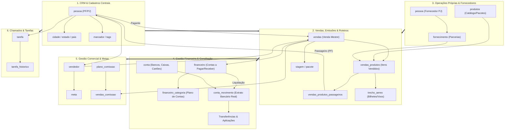
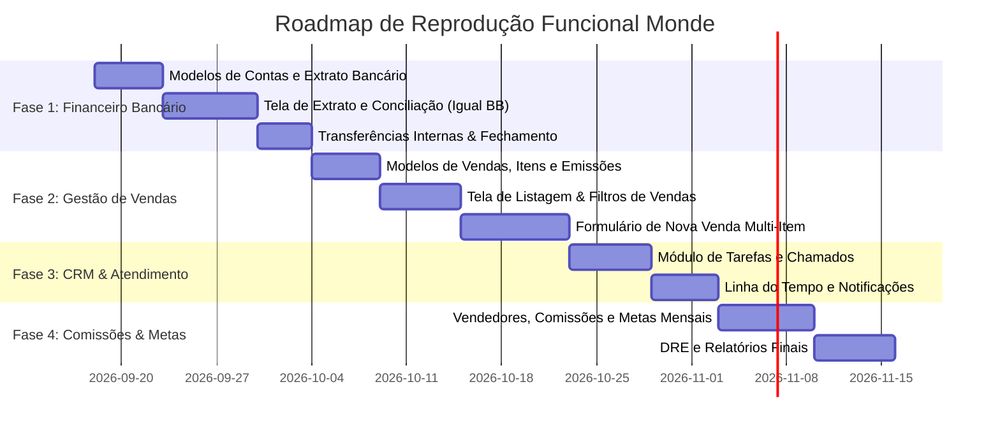

# Arquitetura & Mapeamento Funcional Completo: Monde ERP ➔ Destino Certo

> **Documento Técnico de Engenharia Reversa e Plano de Reprodução Funcional**  
> **Origem dos Dados Analisados:** Backup PostgreSQL `database_20260917103253.dump` (Schema `destinocertoroteiros`)  
> **Data da Análise:** 17 de Setembro de 2026  
> **Status:** Mapeamento 100% Concluído  

---

## 1. Visão Geral Executiva

A análise profunda realizada sobre o banco de dados oficial do sistema **Monde** revelou uma arquitetura madura voltada especificamente para operadoras e agências de viagens e turismo. O banco é composto por **106 tabelas**, interligadas por mais de **200 chaves estrangeiras (Foreign Keys)**, controlando desde a prospecção inicial do passageiro até a conciliação bancária centavo por centavo e a apuração contábil/fiscal.

### 📊 Panorama Quantitativo do Banco de Dados Real

| Dimensão Operacional | Tabela Principal | Volume de Registros no Dump | Descrição no Negócio |
| :--- | :--- | :---: | :--- |
| **Pessoas & Cadastros** | `pessoa` | **4.496** | Clientes PF (3.670) e Fornecedores PJ (826) |
| **Vendas de Viagens** | `vendas` | **3.894** | Contratos de viagens e reservas fechadas |
| **Itens & Serviços Vendidos** | `vendas_produtos` | **7.313** | Aéreos, hospedagens, pacotes, seguros, etc. |
| **Passageiros Alocados** | `vendas_produtos_passageiros` | **11.834** | Vínculo individual de passageiros aos serviços |
| **Trechos Aéreos Emitidos** | `trecho_aereo` | **2.925** | Bilhetes, voos, localizadores e conexões |
| **Produtos & Pacotes da Agência** | `produtos` / `pacote` | **112 / 83** | Catálogo próprio de excursões e roteiros |
| **Contas a Pagar / Receber** | `financeiro` | **17.942** | Títulos e obrigações comerciais |
| **Detalhamento de Itens Financeiros**| `financeiro_item` | **23.664** | Rateios e fatiamento financeiro por serviço |
| **Plano de Contas / Categorias DRE** | `financeiro_categoria` | **24.614** | Classificação analítica contábil/financeira |
| **Contas Bancárias e Caixas** | `conta` | **12** | Banco do Brasil, Stone, Hipercard, Caixas |
| **Livro-Caixa & Conciliação** | `conta_movimento` | **15.250** | Extrato real com conciliação bancária diária |
| **CRM / Tarefas de Atendimento** | `tarefa` | **433** | Chamados, pós-venda, follow-ups |
| **Histórico de Atendimentos** | `tarefa_historico` | **1.381** | Registro de conversas, e-mails e tratativas |
| **Vendedores Comerciais** | `vendedor` | **14** | Consultores e agentes de viagens |
| **Usuários & Permissões** | `usuario` / `grupo_usuario` | **16 / 5** | Perfis de segurança e operadores do ERP |
| **Trilha de Auditoria** | `log` | **183.165** | Rastreabilidade total de quem alterou o quê |

---

## 2. Mapa Arquitetural de Alto Nível (End-to-End)



---

## 3. Detalhamento dos Módulos Operacionais

### 3.1. Módulo de CRM & Cadastros Gerais

O Monde centraliza todas as entidades sob a tabela unificada `pessoa`, diferenciando Pessoas Físicas (clientes, passageiros, funcionários) de Pessoas Jurídicas (fornecedores, operadoras, consolidadoras, companhias aéreas, bancos).

- **Tabelas Envolvidas:** `pessoa`, `cidade`, `estado`, `pais`, `marcador`, `pessoa_por_marcador`, `pessoa_contato`, `pessoa_anexos`, `funcao_pessoa`, `funcao_pessoa_pessoa`.
- **Campos Chave de `pessoa`:**
  - `tipo`: `'F'` (Pessoa Física) ou `'J'` (Pessoa Jurídica).
  - Documentos: `cpf`, `rg`, `numero_passaporte`, `validade_passaporte`, `cnpj`, `ie`.
  - Dados Pessoais: `nome`, `razao_social`, `data_nascimento`, `sexo`, `estado_civil`, `filiacao_mae`.
  - Contatos: `email`, `telefone`, `telefone_celular`, `telefone_comercial`, `website`.
  - Endereço completo: `endereco`, `numero`, `complemento`, `bairro`, `cep`, `cidade_id`.
  - Inteligência Comercial: `data_primeira_venda`, `data_ultima_venda`, `data_ultimo_embarque`, `data_ultimo_retorno`.
- **Regras de Negócio:**
  1. Classificação dinâmica por Marcadores (`Hotéis`, `Operadoras`, `Cias Aéreas`, `Locadora de Veículos`, `Consolidadores`, `Parceiro Geral`).
  2. Histórico de relacionamento: pessoas podem ser contatos de outras pessoas (`pessoa_contato`).

---

### 3.2. Módulo de Vendas, Emissões & Roteiros

É o núcleo comercial da agência, permitindo vender passagens avulsas, pacotes de terceiros (ex: CVC, Trend, SkyTeam) ou pacotes de operação própria da Destino Certo.

- **Tabelas Envolvidas:** `vendas`, `vendas_produtos`, `vendas_produtos_passageiros`, `vendas_comissao`, `vendas_anexos`, `viagem`, `quotes`.
- **Fluxo de uma Venda:**
  1. **Cabeçalho da Venda (`vendas`):**
     - Número da venda sequencial (`numero`), cliente pagante (`pagante_id`), vendedor responsável (`vendedor_id`), datas de embarque (`data_embarque`) e retorno (`data_retorno`).
     - Totalizadores: `total_produtos`, `total_taxas`, `taxa_servico`, `fee_agencia`, `taxa_du`, `taxa_rav`, `valor_final`, `saldo`.
     - Vínculo com operação própria: `operacao_propria_id` (vincula diretamente a um pacote próprio).
  2. **Itens Vendidos (`vendas_produtos`):**
     - Uma única venda pode ter múltiplos itens: 1 Aéreo Latam + 1 Hotel em Gramado + 1 Seguro Assist Card.
     - Cada item registra: fornecedor (`fornecimento_id`), datas (`data_inicio`, `data_fim`), valores em moeda de origem e convertida, diárias, regime, tipo de acomodação.
  3. **Passageiros por Item (`vendas_produtos_passageiros`):**
     - Cada produto vendido tem a lista de passageiros associados com número de documento, nome na emissão e valores individuais de tarifa e taxas.
  4. **Emissões Aéreas (`trecho_aereo`):**
     - Armazena código localizador (PNR), número do e-ticket/bilhete, voo, classe tarifária, origem (`aeroporto_saida_id`), destino (`aeroporto_chegada_id`), data/hora de decolagem e pouso.

---

### 3.3. Módulo de Operações Próprias (Pacotes & Excursões)

O Monde possui suporte nativo a **Grupos e Operações Próprias**, o que corresponde exatamente ao core do Destino Certo.

- **Tabelas Envolvidas:** `produtos`, `pacote`, `fornecimento`, `representacao`.
- **Diferenciação no Banco:**
  - No Monde, quando uma venda é de grupo próprio, o campo `vendas.operacao_propria_id` é preenchido apontando para a tabela `produtos`.
  - A tabela `pacote` descreve os serviços inclusos e as características gerais do pacote turístico.
  - No Destino Certo, essa funcionalidade é expandida com o sistema de **Blocos dinâmicos** (Rodoviário, Aéreo, Hospedagem, Rooming List, Guias e Checkout).

---

### 3.4. Módulo Financeiro, Contas & Conciliação Bancária

Este é o módulo que foi auditado no print do **Banco do Brasil** e representa o coração contábil da empresa.

- **Tabelas Envolvidas:** `financeiro`, `financeiro_item`, `financeiro_categoria`, `centro_custo`, `conta`, `conta_movimento`, `conta_cobranca`, `forma_pagamento`, `regra_faturamento`.
- **Diferença Conceitual Crucial (Contas a Pagar/Receber vs. Extrato Bancário):**
  1. **`financeiro` (Títulos e Obrigações):**
     - Representa o que a empresa tem a receber de clientes (`movimento = 'C'`) e a pagar a fornecedores/reembolsos (`movimento = 'D'`).
     - Possui data de vencimento (`vencimento`), valor previsto (`valor`), data de liquidação (`liquidacao`) e status (`PAGO` ou `PENDENTE`).
  2. **`conta` (Contas Bancárias e Caixas):**
     - Cadastra todas as contas da agência:
       - `Banco do Brasil` (Conta Corrente)
       - `APLICAÇÃO` (Conta Investimento/Reserva)
       - `Conta Stone - João Guilherme` / `Conta Stone - George` (Contas de maquininha)
       - `Dinheiro` (Caixa Físico)
       - Cartões corporativos (`Hipercard`, `Bradesco`, `Itaú Infinity`, `Nubank`).
  3. **`conta_movimento` (Livro-Caixa e Conciliação Bancária Diária):**
     - É exatamente a tela exibida no print da Monde!
     - Registra o fluxo de caixa real: toda entrada (crédito) e saída (débito) que entrou ou saiu da conta bancária.
     - Suporta **Transferências entre Contas** (como os `R$ 4.643,87` transferidos do BB para a Aplicação no dia 15/09).
     - Permite o **Fechamento de Caixa Diário** (o checkbox "Fechado" com saldo R$ 0,00).
  4. **`financeiro_categoria` & `centro_custo` (Plano de Contas Gerencial):**
     - Classifica cada lançamento: `RECEITA DE VENDAS`, `FORNECEDOR (PASSAGEM AEREA)`, `REEMBOLSO`, `TARIFA BANCARIA`, `MATERIAL DE ESCRITORIO / COPA`.
     - Permite emitir DRE (Demonstrativo do Resultado do Exercício) e fluxo de caixa categorizado.

---

### 3.5. Módulo de Vendedores, Comissões & Metas

Gerencia a produtividade da equipe comercial e o cálculo de comissões por venda e produto.

- **Tabelas Envolvidas:** `vendedor`, `plano_comissao`, `plano_comissao_meta`, `plano_comissao_pessoa`, `plano_comissao_produto`, `meta`, `vendas_comissao`.
- **Regras:**
  - Vendedores possuem metas mensais de faturamento e margem.
  - Planos de comissão podem ser globais (percentual fixo sobre o total da venda) ou diferenciados por produto (ex: 10% em seguro viagem, 3% em aéreo, 7% em pacote próprio).
  - Rateio de comissões quando mais de um atendente/vendedor participa da negociação.

---

### 3.6. Módulo de CRM, Atendimento & Tarefas

Sistema de acompanhamento comercial e suporte ao cliente.

- **Tabelas Envolvidas:** `tarefa`, `tarefa_historico`, `categoria_tarefa`, `task_historic_attachments`, `notificacao`.
- **Funcionalidades:**
  - Tarefas vinculadas a um cliente, uma venda ou fornecedor.
  - Definição de prioridade, responsável e prazo limite (`data_limite`).
  - Histórico de interações: ligações, mensagens de WhatsApp, anotações de follow-up.
  - Alertas automáticos para tarefas atrasadas ou próximas do vencimento.

---

## 4. Matriz de Paridade: Monde ERP vs. Destino Certo Atual

| Módulo / Funcionalidade | No Monde ERP | No Destino Certo (Atual) | Status | Ação Necessária |
| :--- | :---: | :---: | :---: | :--- |
| **Cadastro de Clientes (PF)** | `pessoa` (PF) | `Customer` | ✅ **100%** | Concluído (3.670 clientes importados) |
| **Cadastro de Fornecedores (PJ)** | `pessoa` (PJ) | `Supplier` | ✅ **100%** | Concluído (826 fornecedores com categorias) |
| **Contas a Pagar e Receber** | `financeiro` | `FinancialEntry` | ✅ **100%** | Concluído (17.945 lançamentos importados) |
| **Histórico de Viagens dos Clientes**| `CustomerTrip` | `CustomerTrip` | ✅ **100%** | Concluído (6.892 viagens importadas) |
| **Grafo Social de Passageiros** | Não possui | `/rede-social` | 🚀 **Superior** | Exclusivo do Destino Certo (Obsidian Graph View) |
| **Construtor de Excursões/Pacotes** | `pacote` básico | `/excursoes` (Blocos) | 🚀 **Superior** | Exclusivo do Destino Certo (Aéreo, Hotel, Roomlist) |
| **Quadro de Notas / Miro Canvas** | Não possui | `/notas` (Canvas) | 🚀 **Superior** | Exclusivo do Destino Certo |
| **Contas Bancárias (BB, Stone, Caixas)**| `conta` (12 contas) | Parcial (no dump) | ⚠️ **Pendente** | Criar modelo `BankAccount` e tela de contas |
| **Extrato & Conciliação Bancária** | `conta_movimento` | Parcial (no dump) | ⚠️ **Pendente** | Criar modelo `BankTransaction` e tela igual ao print |
| **Transferências entre Contas** | `conta_movimento` | Parcial (no dump) | ⚠️ **Pendente** | Suporte a transferências (ex: CC para Aplicação) |
| **Categorias de Despesa / DRE** | `categoria_financeiro` | Parcial | ⚠️ **Pendente** | Criar plano de contas gerencial completo |
| **Gestão Completa de Vendas** | `vendas` / `vendas_produtos` | Parcial (CustomerTrip) | ⚠️ **Pendente** | Criar tela de Vendas com itens e passageiros |
| **Emissão de Bilhetes Aéreos** | `trecho_aereo` | Apenas na Excursão | ⚠️ **Pendente** | Permitir emissão de bilhetes avulsos na venda |
| **CRM de Tarefas / Atendimento** | `tarefa` / histórico | Não possui | ⚠️ **Pendente** | Criar módulo de Tarefas e Histórico de CRM |
| **Comissões & Metas de Vendedores** | `vendedor` / `meta` | Não possui | ⚠️ **Pendente** | Criar apuração de comissões e metas |

---

## 5. Modelagem Recomendada para o Prisma (`prisma/schema.prisma`)

Para incorporar todas as funcionalidades do Monde sem quebrar nada do que já funciona no Destino Certo, a expansão do banco de dados deve seguir a seguinte estrutura:

```prisma
// ==========================================
// 1. MÓDULO FINANCEIRO: CONTAS & EXTRATO BANCÁRIO
// ==========================================

model BankAccount {
  id          String   @id @default(cuid())
  mondeId     String?  @unique
  name        String   // "Banco do Brasil", "APLICAÇÃO", "Conta Stone - George"
  bankCode    String?  // "001", "22397"
  agency      String?
  accountNumber String?
  type        String   @default("CORRENTE") // "CORRENTE", "APLICACAO", "CAIXA", "CARTAO"
  initialBalance Decimal @default(0) @db.Decimal(12, 2)
  currentBalance Decimal @default(0) @db.Decimal(12, 2)
  active      Boolean  @default(true)
  createdAt   DateTime @default(now())
  updatedAt   DateTime @updatedAt

  transactions BankTransaction[]
  transfersFrom BankTransfer[] @relation("TransfersFrom")
  transfersTo   BankTransfer[] @relation("TransfersTo")
}

model BankTransaction {
  id              String       @id @default(cuid())
  mondeId         String?      @unique
  accountId       String
  account         BankAccount  @relation(fields: [accountId], references: [id], onDelete: Cascade)
  financialEntryId String?
  financialEntry  FinancialEntry? @relation(fields: [financialEntryId], references: [id], onDelete: SetNull)
  
  date            DateTime     // Data da liquidação/extrato
  amount          Decimal      @db.Decimal(12, 2) // Positivo (Crédito) ou Negativo (Débito)
  description     String
  document        String?      // "PIX", "BOLETO", "DEPOSITO"
  isReconciled    Boolean      @default(false)
  categoryName    String?      // "RECEITA DE VENDAS", "FORNECEDOR (PASSAGEM AEREA)", "TARIFA BANCARIA"
  
  createdAt       DateTime     @default(now())

  @@index([accountId, date])
  @@index([date])
}

model BankTransfer {
  id            String      @id @default(cuid())
  fromAccountId String
  fromAccount   BankAccount @relation("TransfersFrom", fields: [fromAccountId], references: [id])
  toAccountId   String
  toAccount     BankAccount @relation("TransfersTo", fields: [toAccountId], references: [id])
  amount        Decimal     @db.Decimal(12, 2)
  date          DateTime
  description   String?     // Ex: "Transferência para APLICAÇÃO"
  createdAt     DateTime    @default(now())
}

// ==========================================
// 2. MÓDULO DE VENDAS & ITENS EMITIDOS
// ==========================================

enum SaleStatus {
  ORCAMENTO
  CONFIRMADA
  EM_ANDAMENTO
  FINALIZADA
  CANCELADA
}

model Sale {
  id              String      @id @default(cuid())
  mondeId         String?     @unique
  saleNumber      String      @unique // Ex: "3849"
  customerId      String      // Pagante da venda
  customer        Customer    @relation(fields: [customerId], references: [id])
  sellerId        String?     // Vendedor
  seller          Seller?     @relation(fields: [sellerId], references: [id])
  excursionId     String?     // Vínculo opcional se for uma excursão própria
  excursion       Excursion?  @relation(fields: [excursionId], references: [id])
  
  saleDate        DateTime    @default(now())
  departureDate   DateTime?
  returnDate      DateTime?
  status          SaleStatus  @default(CONFIRMADA)
  
  totalProducts   Decimal     @default(0) @db.Decimal(12, 2)
  totalTaxes      Decimal     @default(0) @db.Decimal(12, 2)
  serviceFee      Decimal     @default(0) @db.Decimal(12, 2)
  discount        Decimal     @default(0) @db.Decimal(12, 2)
  finalAmount     Decimal     @db.Decimal(12, 2)
  
  notes           String?
  financialNotes  String?
  
  createdAt       DateTime    @default(now())
  updatedAt       DateTime    @updatedAt

  items           SaleItem[]
  passengers      SalePassenger[]
  financialEntries FinancialEntry[]

  @@index([saleNumber])
  @@index([customerId])
  @@index([saleDate])
}

model SaleItem {
  id              String    @id @default(cuid())
  saleId          String
  sale            Sale      @relation(fields: [saleId], references: [id], onDelete: Cascade)
  supplierId      String?
  supplier        Supplier? @relation(fields: [supplierId], references: [id])
  
  type            String    // "AEREO", "HOSPEDAGEM", "PACOTE", "SEGURO", "TRANSFER", "CRUZEIRO"
  description     String
  startDate       DateTime?
  endDate         DateTime?
  quantity        Int       @default(1)
  unitPrice       Decimal   @db.Decimal(12, 2)
  taxAmount       Decimal   @default(0) @db.Decimal(12, 2)
  totalAmount     Decimal   @db.Decimal(12, 2)
  
  // Detalhes de Aéreo se aplicável
  airlineCode     String?
  locCode         String?   // Localizador (PNR)
  ticketNumber    String?
  
  // Detalhes de Hospedagem se aplicável
  roomType        String?
  boardType       String?   // "Café da manhã", "All Inclusive"
  
  createdAt       DateTime  @default(now())

  @@index([saleId])
}

model SalePassenger {
  id          String   @id @default(cuid())
  saleId      String
  sale        Sale     @relation(fields: [saleId], references: [id], onDelete: Cascade)
  customerId  String
  customer    Customer @relation(fields: [customerId], references: [id])
  role        String   @default("PASSAGEIRO") // "PASSAGEIRO", "PAGANTE", "PAGANTE_E_PASSAGEIRO"
  seatNumber  String?
  ticketCode  String?
  
  @@unique([saleId, customerId])
}

// ==========================================
// 3. MÓDULO COMERCIAL: VENDEDORES & METAS
// ==========================================

model Seller {
  id          String   @id @default(cuid())
  mondeId     String?  @unique
  name        String
  email       String?
  phone       String?
  commissionRate Float @default(0)
  active      Boolean  @default(true)
  createdAt   DateTime @default(now())
  
  sales       Sale[]
  goals       SellerGoal[]
}

model SellerGoal {
  id          String   @id @default(cuid())
  sellerId    String
  seller      Seller   @relation(fields: [sellerId], references: [id], onDelete: Cascade)
  month       String   // "2026-09"
  targetAmount Decimal @db.Decimal(12, 2)
  achievedAmount Decimal @default(0) @db.Decimal(12, 2)
}

// ==========================================
// 4. MÓDULO DE CRM: TAREFAS & ATENDIMENTO
// ==========================================

model Task {
  id          String    @id @default(cuid())
  mondeId     String?   @unique
  title       String
  description String?
  category    String    // "Pós-venda", "Cobrança", "Follow-up", "Emissão"
  priority    String    @default("MEDIA") // "BAIXA", "MEDIA", "ALTA", "URGENTE"
  status      String    @default("PENDENTE") // "PENDENTE", "EM_ANDAMENTO", "CONCLUIDA"
  dueDate     DateTime?
  
  customerId  String?
  customer    Customer? @relation(fields: [customerId], references: [id], onDelete: SetNull)
  assignedToId String?
  assignedTo  User?     @relation(fields: [assignedToId], references: [id], onDelete: SetNull)
  
  createdAt   DateTime  @default(now())
  updatedAt   DateTime  @updatedAt
  
  history     TaskHistory[]

  @@index([status, dueDate])
}

model TaskHistory {
  id          String   @id @default(cuid())
  taskId      String
  task        Task     @relation(fields: [taskId], references: [id], onDelete: Cascade)
  actionNote  String
  authorName  String
  createdAt   DateTime @default(now())
}
```

---

## 6. Roadmap de Implementação em 4 Fases

Para implementar todas as funcionalidades do Monde no Destino Certo mantendo estabilidade total:



### Fase 1: Financeiro Bancário & Conciliação Diária (Prioridade Máxima)
- **Objetivo:** Ter exatamente a tela do print da Monde dentro do Destino Certo (`/financeiro/extrato`).
- **Entregáveis:**
  1. Cadastro das 12 contas bancárias já mapeadas (`Banco do Brasil`, `Stone`, `Aplicação`, caixas físicos).
  2. Extrato bancário diário com filtro por conta e período de datas.
  3. Conciliação com botão de "Fechar Dia" (saldo R$ 0,00 com transferência para aplicação).
  4. Importação contínua das movimentações de `conta_movimento` do dump.

### Fase 2: Módulo Completo de Vendas & Emissões
- **Objetivo:** Gerenciar as vendas da agência com seus múltiplos passageiros e itens.
- **Entregáveis:**
  1. Tela de Vendas (`/vendas`) com filtros por pagante, vendedor, período e status.
  2. Ficha completa da Venda com abas: Passageiros, Itens (Aéreo, Hotel, Pacote Próprio), Financeiro vinculado e Comissões.
  3. Conexão direta das Vendas de Pacotes Próprios com o módulo de Excursões (`/excursoes/[id]`).

### Fase 3: CRM de Atendimento & Tarefas
- **Objetivo:** Substituir o sistema de pós-venda e lembretes da Monde.
- **Entregáveis:**
  1. Quadro Kanban ou lista de tarefas (`/tarefas`) por atendente.
  2. Histórico de tratativas na página de cada cliente (`/clientes/[id]`).
  3. Alertas automáticos no Cockpit para tarefas vencidas.

### Fase 4: Comissões, Metas & DRE Analítico
- **Objetivo:** Relatórios de performance comercial e lucratividade real da agência.
- **Entregáveis:**
  1. Painel de metas por vendedor com barra de progresso em tempo real.
  2. Extrato de comissões liberadas vs. comissões a receber.
  3. DRE Gerencial consolidando receitas de vendas, custos de fornecedores e despesas operacionais.

---

## 7. Conclusão

A arquitetura do Monde está **completamente compreendida e documentada**. Como os dados de pessoas, lançamentos financeiros e histórico de viagens já foram migrados para o banco de dados PostgreSQL do Destino Certo, a base para reproduzir 100% das telas da Monde sobre uma interface moderna, rápida e responsiva já está pronta para ser desenvolvida conforme o roadmap acima.
